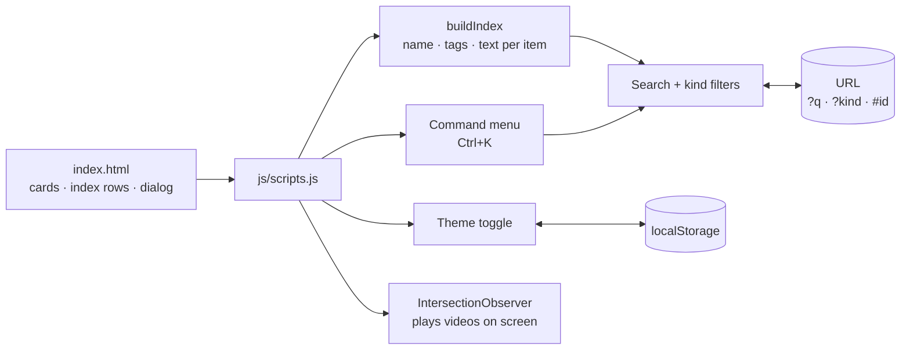
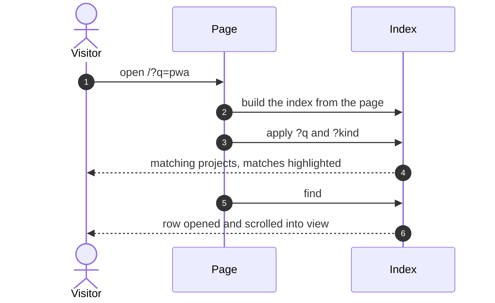

<div align="center">

# 🌐 pero-grubac.github.io

[](https://github.com/pero-grubac/pero-grubac.github.io/actions/workflows/ci.yml)
[](https://github.com/pero-grubac/pero-grubac.github.io/actions/workflows/deploy.yml)


**My portfolio: 30 projects behind one search bar, live apps that open in place, a command menu and a light/dark theme, in plain HTML, CSS and JavaScript.**

[](https://pero-grubac.github.io)


</div>

---

## 📌 Project Overview

A portfolio built from scratch without frameworks or a build step. Every project is in one **Projects** section with a single search bar (`grep -i …`) and kind filters. Rows open in place with a preview, a short description and the key points, and live apps launch straight from their row.

Searches and filters live in the URL, so `?q=docker`, `?kind=live` or `#arcane-keep` opens that exact view.

---

## ✨ Features

- 🔎 **One search for everything**: names, descriptions and tags, with matches highlighted; clicking a Tech Stack tag searches for it
- 🗂️ **Kind filters**: systems · live · mobile · desktop · web · tool
- 🎬 **Featured systems** with demo videos that play only while on screen
- 📂 **Index rows** that open in place, with previews of every live app
- ⌨️ **Command menu** (`Ctrl` + `K`): jump to a project, launch an app, copy the email, switch theme
- 🌗 **Light and dark theme** following the system, switchable and remembered
- 🔗 **Shareable views** through `?q=`, `?kind=` and `#project`
- 📱 **Responsive**, with a collapsible menu on phones
- ♿ **Keyboard first**: everything is reachable without a mouse

### 🗂️ Projects

**Featured systems** (each with a demo video):

1. **Incident Alert**: citizen incident reports with moderation, four .NET 10 services (ASP.NET · MassTransit/RabbitMQ · ML.NET · React · Docker)
2. **eMobilityHub**: electric vehicle rental platform, four apps on one database (Spring Boot · Angular · JSP · MySQL · Docker)
3. **Chat Room**: secure forum with 2FA, OAuth2, WAF, SIEM and TLS on every hop (Spring Boot · React · JWT · Docker)
4. **Online Library System**: seven Java apps (REST · TCP/TLS sockets · UDP multicast · RabbitMQ · RMI · Redis)

**Index**:

- **Live apps**: [RepoHealth](https://repository-health-monitor.vercel.app/), Brick Breaker, Monte Carlo π · Python, Arcane Keep, DevKit, GitHub Dashboard, Dev Timeline, Countdown, Catan Map Generator, excuse.exe, Sedmica, Lora Score Table, Yamb Table
- **Mobile**: FitForge, AssetManager, ETF Oglasi (Flutter · Dart · SQLite)
- **Desktop**: Store Management, Store Chain Management (C# · WinForms · MySQL), e-Mobility Rental (Java · Swing), ANOVA, Echo Player, Monte Carlo π, Snake (C# · WPF)
- **Web**: Minimal Blog (Python · Django · PostgreSQL)
- **Tools**: Secure Repository (C# · OpenSSL · PKI), GitHub Discord Bot (Python · discord.py · Flask · PostgreSQL)

### ⌨️ Keyboard

| Key | Action |
|-----|--------|
| `/` | Search projects |
| `Ctrl` + `K` | Command menu |
| `t` | Toggle light / dark theme |
| `j` / `k` | Move between index rows · `Enter` opens · `o` launches a live app |
| `Esc` | Clear the search |

---

## 🛠️ Tech Stack

| Technology | Usage |
|------------|-------|
| HTML5 | Structure, `<details>` rows, `<dialog>` command menu |
| CSS3 | OKLCH colour tokens (light + dark), animations, responsive layout |
| Vanilla JavaScript | Search, filters, command menu, keyboard shortcuts, theme, lazy video |
| Google Fonts | Space Grotesk (display) · Inter (body) · JetBrains Mono (code/labels) |
| Font Awesome | Icons |
| `node:test` | Static checks: links, assets, anchors, ids, thumbnails |
| Playwright | End-to-end smoke tests on desktop and phone |
| Lighthouse CI | Performance, accessibility, best practices and SEO on every pull request |
| GitHub Actions + GitHub Pages | CI and deployment |

---

## 📁 Project Structure

> **Redesign in progress on the `redesign` branch** (see `REDESIGN.md`).
> The site is being rebuilt with Astro. Project Structure, Installation,
> Usage, Tests and CI/CD describe the new setup; the rest of this README
> still describes the live site and is rewritten at launch.

```
pero-grubac.github.io/
├── src/
│   ├── pages/                 Routes (index.astro so far)
│   ├── layouts/Base.astro     Head, fonts, masthead, main, footer
│   ├── components/            Masthead, Footer, FontFaces
│   └── styles/                tokens.css (design tokens), global.css
├── public/assets/             Images, videos, og-card.png, served at /assets/
├── astro.config.mjs           Static output, trailingSlash "always"
├── design-explorations/       Phase 0 prototypes (direction B is the reference)
├── legacy/                    The old hand-written site, until launch
├── REDESIGN.md                The redesign spec
└── .github/workflows/
    ├── ci.yml                 astro check + build on every push and pull request
    └── deploy.yml             After CI passes on main: withastro/action → GitHub Pages
```

---

## 📦 Installation

You need [Git](https://git-scm.com/) and [Node.js](https://nodejs.org/) 22.12 or newer.

```bash
git clone https://github.com/pero-grubac/pero-grubac.github.io.git
cd pero-grubac.github.io
npm install
```

---

## ▶️ Usage

```bash
npm run dev        # http://localhost:4321, reloads on change
npm run check      # TypeScript and Astro diagnostics
npm run build      # static site in dist/
npm run preview    # serves dist/
```

### Tests

Browser tests and Lighthouse checks for the new site come in phase 5 of
`REDESIGN.md`. The old site's tests are kept in `legacy/tests/` and no
longer run.

---

## 🏗️ Architecture



### Opening a shared link



---

## 🚀 CI/CD

| Workflow | Runs on | What it does |
|----------|---------|--------------|
| `ci.yml` | Every push (including `main`) and pull request | `npm ci`, `astro check`, `astro build` |
| `deploy.yml` | After **CI passes on `main`**, or a manual run | `withastro/action` builds `dist/` and uploads it; `actions/deploy-pages` publishes it |

Deploy is chained to CI (`workflow_run`): a push to `main` is tested once, and only a green run is published, from exactly the commit that was tested. Documentation-only commits start neither. Nothing deploys from other branches, so the redesign goes live only when `redesign` is merged into `main`.

CI **skips documentation-only changes** (`*.md`, `readme_assets/`, `LICENSE`, `.gitignore`, `.vscode/`), and a newer run on the same branch cancels the older one. Only the build output (`dist/`) is deployed; `legacy/` and `design-explorations/` never are.

**One-time setup:** **Settings → Pages → Build and deployment → Source** → **GitHub Actions**. Until then GitHub keeps publishing `main` directly and the checks don't gate the deploy.

---

## 🧭 Design Decisions

- **No framework, no build.** The page is content first; plain HTML is fast, crawlable and works without JavaScript, which then adds search and shortcuts on top.
- **One search for everything** instead of separate sections, so a visitor looking for "docker" or "pwa" finds every match at once.
- **State in the URL**, so any view can be shared.
- **Videos only play on screen**, which keeps the page light on phones.
- **Decorations never widen the page**: the background glows are clipped to their sections, and a test checks that nothing is wider than the screen.
