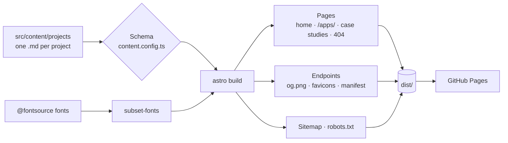
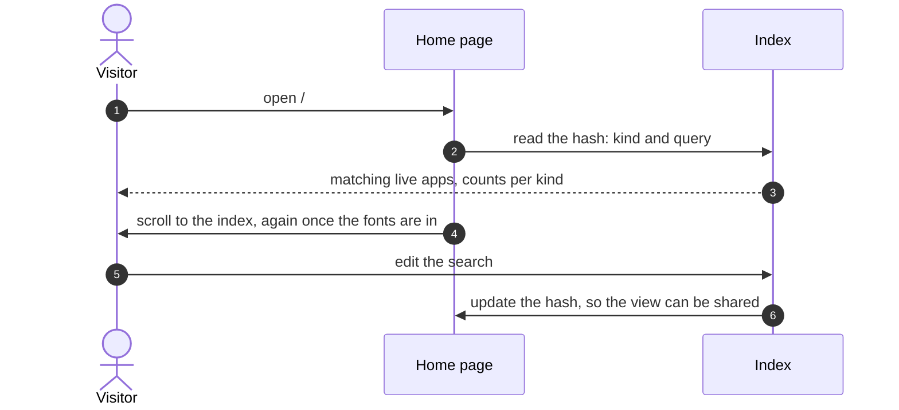

<div align="center">

# 🌐 pero-grubac.github.io

[](https://github.com/pero-grubac/pero-grubac.github.io/actions/workflows/ci.yml)
[](https://github.com/pero-grubac/pero-grubac.github.io/actions/workflows/deploy.yml)


**My portfolio: backend systems as magazine features with case studies and architecture diagrams, every other project in one searchable index, and a gallery of browser apps. Built with Astro, set like a printed page.**

[](https://pero-grubac.github.io)


</div>

---

## 📌 Project Overview

A static portfolio for a backend developer. The four systems come first, each as a feature with its architecture line, a demo video that plays only when you ask for it, and a case study with an architecture diagram. Every other project is a one-line entry in an index that opens on demand, with search and kind filters, and the browser apps have a gallery of their own.

Each project is one Markdown file. A strict schema checks it at build time, and every count on the site is computed from those files.

---

## ✨ Features

- 🏗️ **Systems as features**: headline, architecture line, description, and a demo video (AV1 WebM, with an H.264 MP4 as fallback) that loads only on hover, click or tap
- 📖 **Case studies** for every project with a public repo, with an architecture diagram where a project has parts that talk to each other, and a sticky margin: on this page, stack, code
- 🔎 **Index of projects**: search by title, summary or technology, kind filters with live counts, one entry open at a time; the state lives in the URL (`#projects?kind=live&q=react`)
- 🧭 **Command palette** (`Ctrl` / `⌘` + `K`) on every page: sections, every project, open an app, copy the email
- 🖼️ **Browser apps** gallery at `/apps/`, each app one click from its screenshot
- 🗞️ **Social images** for every page, set at build time in the site's own fonts
- ♿ **Accessible**: keyboard only, visible focus everywhere, reduced motion respected, axe clean
- ⚡ **Fast**: about 3 kB of JavaScript on the home page, fonts subset to the characters the site uses

### 🗂️ Projects

**Featured systems** (each with a demo video and a case study):

1. **Incident Alert**: citizen incident reports with moderation, four .NET 10 services (ASP.NET · MassTransit/RabbitMQ · ML.NET · React · Docker)
2. **eMobilityHub**: electric vehicle rental platform, four apps on one database (Spring Boot · Angular · JSP · MySQL · Docker)
3. **Chat Room**: secure forum with 2FA, OAuth2, WAF, SIEM and TLS on every hop (Spring Boot · React · JWT · Docker)
4. **Online Library System**: seven Java apps (REST · TCP/TLS sockets · UDP multicast · RabbitMQ · RMI · Redis)

**Index**:

- **Live apps**: [RepoHealth](https://repository-health-monitor.vercel.app/), Brick Breaker, Monte Carlo π · Python, Arcane Keep, DevKit, GitHub Dashboard, Dev Timeline, Countdown, Catan Map Generator, excuse.exe, Sedmica, Lora Score Table, Yamb Table
- **Mobile**: FitForge, AssetManager, ETF Oglasi (Flutter · Dart · SQLite)
- **Desktop**: Store Management, Store Chain Management (C# · WinForms · MySQL), e-Mobility Rental (Java · Swing), ANOVA, Echo Player, Monte Carlo π, Snake (C# · WPF)
- **Web**: Minimal Blog (Python · Django · PostgreSQL)
- **Tools**: Secure Repository (C# · OpenSSL · PKI), GitHub Discord Bot (Python · discord.py · Flask · PostgreSQL)

### ⌨️ Keyboard

| Key | Action |
|-----|--------|
| `/` | Find in the index (home) or in the apps (`/apps/`) |
| `Ctrl` / `⌘` + `K` | Command palette, from any page, even while typing |
| `↑` `↓` `Enter` | Move through the palette and run a row |
| `Esc` | Close the palette, or the open index entry |

On a touch screen without a mouse the pages leave these hints out; the Search pill still opens the palette.

---

## 🛠️ Tech Stack

| Technology | Usage |
|------------|-------|
| Astro 7 | Static site: pages, content collections, image pipeline (AVIF and WebP), sitemap |
| TypeScript (strict) | Components, the content schema and the browser scripts |
| Zod (via Astro) | The project schema: the build fails on an invalid project file |
| CSS custom properties | The design tokens: paper, ink, one accent, rules; no framework |
| Vanilla TypeScript | Search, filters and hash state, the palette, the demo videos, Copy |
| Newsreader and Instrument Sans | Self-hosted from `@fontsource`, subset at build time with HarfBuzz |
| fontkit and sharp | Social images and favicons, typeset as paths in the site's own fonts |
| Playwright and axe | Browser tests at 360 and 1440 px, keyboard only, reduced motion, accessibility |
| Lighthouse CI | Performance, accessibility, best practices and SEO on every push |
| GitHub Actions and GitHub Pages | CI and deployment |

---

## 📁 Project Structure

```
pero-grubac.github.io/
├── src/
│   ├── content/projects/      One Markdown file per project (<slug>.md)
│   ├── content.config.ts      The projects schema; the build fails on an invalid file
│   ├── assets/                Project screenshots and the portrait, optimized by Astro
│   ├── pages/                 Routes: index, apps, projects/[slug] (case studies), 404, and endpoints
│   │                          for the social images (og.png; assets/og-card.png for home), favicons
│   │                          and site.webmanifest
│   ├── layouts/Base.astro     Head (<Seo>), icons, fonts, masthead, main, footer, toast, palette
│   ├── components/            Seo, Palette, Masthead, Footer, FontFaces and shared pieces (links, demo figure, …)
│   │   ├── home/              The home page sections: hero, about, systems, index, apps, contact
│   │   ├── diagram/           Shapes for architecture diagrams (Diagram, Node, Edge, Actor, Group)
│   │   └── diagrams/          One architecture diagram per system, named after its slug
│   ├── lib/                   Project helpers, the owner's facts, structured data (seo.ts), the other
│   │                          repos' app paths (other-repos.mjs: the path guard and live links share it),
│   │                          and the build-time typesetter for social images and favicons (glyphs, og, icons)
│   ├── integrations/          subset-fonts.mjs: cuts the font files down to what the site uses (build only)
│   ├── scripts/               Browser scripts: the projects index, the palette, copy, the toast
│   ├── types/                 Declarations for the two build packages that ship none
│   └── styles/                tokens.css (design tokens), global.css
├── public/                    robots.txt; assets/: demo videos and avatar, served at /assets/
├── scripts/check-links.mjs    Checks every live, repo and APK link in the content
├── tests/                     Playwright: home, other pages, palette, axe, and the build output (SEO)
├── playwright.config.ts       Runs the tests against `astro preview` of dist/
├── lighthouserc.json          Lighthouse on mobile for home, /apps/ and a case study, and its targets
├── astro.config.mjs           Static output, trailingSlash "always", sitemap, inlined CSS, font subsetting,
│                              and a guard for the other repos' paths
└── .github/workflows/
    ├── ci.yml                 astro check + build, Playwright tests and Lighthouse on every push and PR
    └── deploy.yml             After CI passes on main: withastro/action → GitHub Pages
```

---

## 📦 Installation

You need [Git](https://git-scm.com/) and [Node.js](https://nodejs.org/) 22.12 or newer.

```bash
git clone https://github.com/pero-grubac/pero-grubac.github.io.git
cd pero-grubac.github.io
npm install
```

---

## ▶️ Usage

```bash
npm run dev        # http://localhost:4321, reloads on change
npm run check      # TypeScript and Astro diagnostics
npm run build      # static site in dist/
npm run preview    # serves dist/
npm test           # Playwright tests of the built site (run npm run build first)
npm run lighthouse # Lighthouse on mobile for home, /apps/ and a case study (needs Chrome)
npm run check:links  # every live, repo and APK link in the content must return 200
```

### Adding a project

A project is one file, `src/content/projects/<slug>.md`, and nothing else:
the home page, the index and its counts, `/apps/`, the command palette,
the case study page, its social image, the sitemap and the structured data
all pick it up on the next build.

1. Pick its **kind**, by what a visitor can do with it, the first that fits:
   `system` (shown mainly for its architecture and code), `live` (runs in a
   browser at a URL), `web` (a web project you run yourself), `mobile`
   (installs on a phone), `desktop` (runs on a desktop), `tool` (anything
   else: bots, CLIs, integrations). Technologies are never kinds; they go in
   `stack`.
2. Copy a project file of the same kind and rename it after the new slug.
3. Put the screenshot in `src/assets/<folder>/` (WebP), and for a system the
   demo video in `public/assets/<folder>/` (see Demo videos below).
4. Fill in the fields, then run `npm run build`. The schema
   (`src/content.config.ts`) fails the build with the field and the reason
   if anything doesn't fit.
5. Run `npm test`, and `npm run check:links` to check the new links.

A live app, for example:

```yaml
---
order: 14                       # its place in every list; each number once
slug: countdown                 # kebab-case, the same as the file name
title: "Countdown"
kind: live
applicationCategory: UtilitiesApplication
year: 2026                      # the year its repo was created
summary: "Timers to a duration or a date that survive refreshes and sleep."
metaDescription: "Countdown: as many timers as you like, to a duration or a date. ..."
description: "As many timers as you like, to a duration or a date. ..."
highlights:
  - "Repaint loop pauses in hidden tabs and recalculates the moment you return"
  - "Installable PWA · zero dependencies · 57 unit + 10 Playwright e2e tests"
stack: ["JavaScript", "Web Audio", "Canvas", "PWA", "Playwright"]
links:
  live: "https://pero-grubac.github.io/countdown/"
  repos:
    - label: "Source"
      url: "https://github.com/pero-grubac/countdown"
image: "../../assets/live/countdown.webp"
imageAlt: "Countdown: what the screenshot shows, for screen readers"
featured: false
caseStudy: true
---

The case study, in Markdown (see below).
```

| Field | Rules |
|-------|-------|
| `order`, `slug`, `title`, `kind` | Required. `order` and `slug` are unique; the file is named after the slug |
| `summary` | One sentence, at most 75 characters: the line under the title everywhere |
| `description` | One paragraph; required for systems, shown when an index entry opens |
| `repeatsSummary` | `true` when the description only rewords the summary, so the open entry doesn't show it twice |
| `highlights` | 2–5 short points for every kind but `system` |
| `stack` | Display names (`"Spring Boot"`); each technology once and no counts (`"2× PostgreSQL"`). The search and the About stack terms match these |
| `flow` | Systems only: the architecture line, such as `React → Nginx → Spring Boot → MySQL`; no counts, each technology once |
| `links.live` | Exactly for `live`: an absolute `https://` URL. An app from another repo on this domain must be listed in `src/lib/other-repos.mjs`, which also keeps this site off its path |
| `links.repos` | `{ label, url }` under `github.com/pero-grubac/`: one repo is labelled `Source`, several by their part (`Backend`, `Frontend`). A private repo: `repos: []` and `privateRepo: true`, which shows "Private repo" and never links it |
| `links.apk` | Mobile apps only: the latest release's download |
| `image`, `imageAlt` | Together; the path is relative to the project file. Without a screenshot, list `commands` instead (slash commands, shown as a code block) |
| `video` | Systems only: `/assets/<folder>/demo.mp4`, with `demo.webm` beside it |
| `applicationCategory` | Exactly for `live`: `DeveloperApplication`, `EducationalApplication`, `EntertainmentApplication`, `GameApplication` or `UtilitiesApplication` |
| `featured` | `true` exactly for systems |
| `caseStudy` | `true` builds `/projects/<slug>/`; then `metaDescription` is required: 140–160 characters, unique, what the page offers |
| `year` | Optional |

**The case study** is the Markdown body under the front matter. Write it in
the first person from the project's README, with only the sections the
project has material for, in this order: What it does, How it works (one
application) or Architecture (several parts), Decisions and why, Security,
Testing and deployment. A score table gets one to three short sections, a
system all five. Each `##` heading shows in the page's "On this page" list.
Notes for later go in hidden Markdown comments, such as
`[//]: # "TODO(owner): …"`; the tests fail if one shows on a page.

**An architecture diagram**, for a project made of several parts that talk to
each other, is `src/components/diagrams/<slug>.astro`, drawn with the shapes
in `src/components/diagram/` (copy an existing one). Boxes are applications,
cylinders databases, a double rule a message broker; solid lines are
requests, dashed lines messages through a queue, dotted lines side channels.
The case study shows it when the file exists.

### Demo videos

A system's demo plays only when a visitor asks for it, from two files in
`public/assets/<name>/`: `demo.webm` (AV1), which the page offers first,
and `demo.mp4` (H.264) for browsers that can't decode AV1, such as Safari
on most Apple devices. The WebM is there because some Chromium builds,
including the one Playwright tests with, can't play H.264. The project
file names only the MP4 (`video:`); the build fails if the WebM beside it
is missing. The still shown before it plays is the project's `image`, a
full-size frame of the recording.

Both files come from a 1080p screen recording, without sound, and each
stays under 4 MB. With FFmpeg:

```bash
COLOR="-pix_fmt yuv420p -color_range tv -colorspace bt709 -color_primaries bt709 -color_trc bt709"
ffmpeg -i recording.mp4 -an -c:v libx264 -preset veryslow -crf 26 -profile:v high -level:v 4.0 $COLOR -movflags +faststart demo.mp4
ffmpeg -i recording.mp4 -an -c:v libsvtav1 -preset 4 -crf 46 -svtav1-params scm=1:tune=0 $COLOR demo.webm
```

`scm=1` is SVT-AV1's screen-content mode, which keeps UI text sharp. With a
photo or a map behind the UI it costs more than it saves, so Chat Room and
Incident Alert leave it to the encoder (`scm=2`) and use `-crf 50`.
Incident Alert's busy map doesn't fit in 4 MB at CRF 26 in H.264, so its
MP4 is two-pass at a fixed rate (`-b:v 1068k`, `-pass 1` then `-pass 2`).
Compare a file with the recording (`ffmpeg -i demo.webm -i recording.mp4
-lavfi ssim -f null -`): each is above 0.98 but Incident Alert's MP4, at
0.977. The page declares both files as level 4.0 (`av01.0.08M.08`,
`avc1.640028`), which covers 1080p at 30 fps.

### Tests

`npm test` runs the Playwright tests against the built site (run
`npm run build` first); it starts its own `astro preview` on port 4399
beside any you have open. Locally it uses Edge on Windows (`PW_CHANNEL`
to change); CI uses Playwright's own Chromium, which has no H.264 decoder.
To test with that one locally too: `npx playwright install chromium`, then
`PW_CHANNEL=bundled npm test`.

| File | What it checks |
|------|----------------|
| `tests/home.spec.ts` | Counts, search and hash, details on demand, the demo video, Copy, stack terms, keyboard only, reduced motion, 360 and 1440 px |
| `tests/pages.spec.ts` | `/apps/`, the case studies (breadcrumb, pager, margin, diagram) and the 404, the same ways |
| `tests/palette.spec.ts` | The command palette: shortcut, Esc, backdrop, ↑ ↓ Enter, fuzzy matching, every kind of row |
| `tests/a11y.spec.ts` | axe (WCAG 2.1 A and AA) on every kind of page, with an entry open and with the palette open |
| `tests/build.spec.ts` | `dist/` without a browser: internal links, titles and descriptions, canonical, Open Graph, JSON-LD, sitemap, robots.txt, icons, social images, demo video sources, font subsets |

`npm run lighthouse` runs Lighthouse CI (fetched with `npx`) on mobile
for home, `/apps/` and a case study. It fails below performance 95 or
below 100 for accessibility, best practices and SEO, and warns when the
LCP passes 2.5 s or the CLS 0.05.

---

## 🏗️ Architecture



Everything is decided at build time: counts, the index, the palette rows, the structured data and the social images all come from the project files. The browser gets plain HTML with every project's details already in it, and small scripts that show and hide them.

### Opening a shared link



---

## 🚀 CI/CD

| Workflow | Runs on | What it does |
|----------|---------|--------------|
| `ci.yml` | Every push (including `main`) and pull request | Three jobs side by side: `astro check` and `astro build`; the Playwright tests; Lighthouse (reports kept as an artifact) |
| `deploy.yml` | After **CI passes on `main`**, or a manual run | `withastro/action` builds `dist/` and uploads it; `actions/deploy-pages` publishes it |

Deploy is chained to CI (`workflow_run`): a push to `main` is tested once, and only a green run is published, from exactly the commit that was tested. Documentation-only commits start neither. Nothing deploys from other branches.

CI **skips documentation-only changes** (`*.md`, `readme_assets/`, `LICENSE`, `.gitignore`, `.vscode/`), and a newer run on the same branch cancels the older one. Only the build output (`dist/`) is deployed.

The repository's **Settings → Pages → Build and deployment → Source** must be **GitHub Actions**; with "Deploy from a branch", GitHub would publish the repository root instead of `dist/`.

---

## 🧭 Design Decisions

- **Backend first.** The systems get the most space; small apps and games sit in a compact index that opens on demand, so the home page reads in under a minute.
- **One file per project.** Adding a project means adding one Markdown file; a strict schema rejects anything the pages can't show, and no count is ever typed by hand.
- **Static and small.** No framework on the page and no backend: plain HTML, a few kilobytes of script, and details that are in the HTML for search engines even while collapsed.
- **Set like a printed page.** Paper, ink, rules and two typefaces carry the design; one accent colour marks only what you can act on.
- **Nothing moves on its own.** Videos play only on hover, click or tap, and with reduced motion only on click or tap.
- **State in the URL**, so any view of the index can be shared.
- **Checked on every push**: browser tests, axe and Lighthouse run in CI, and the deploy publishes only a commit that passed them.
