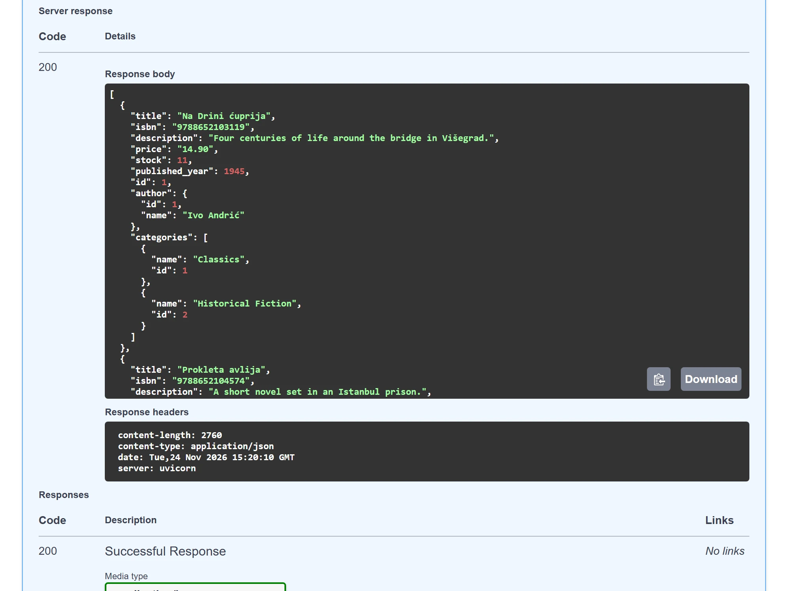
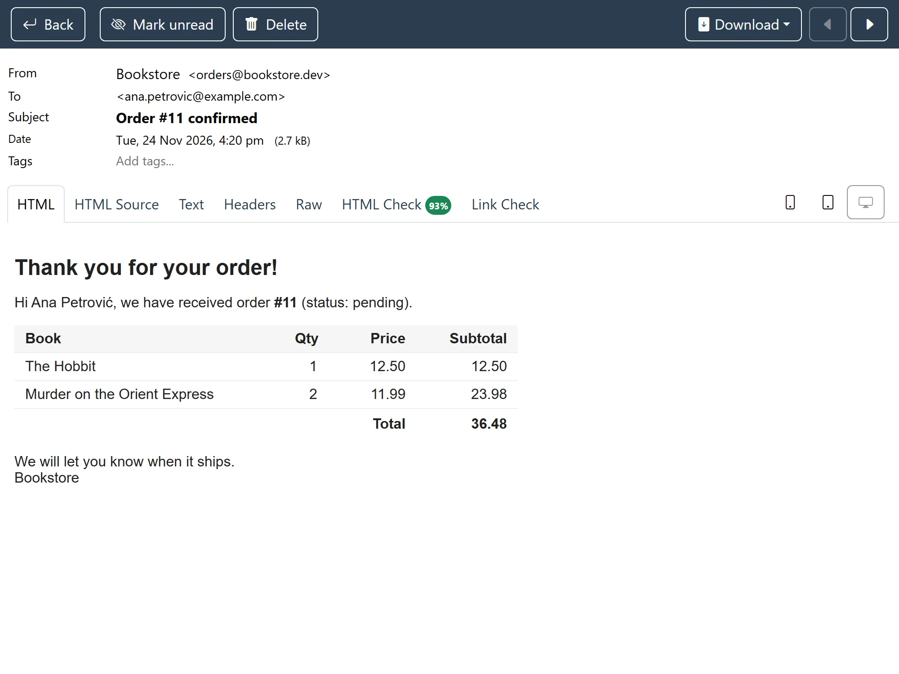
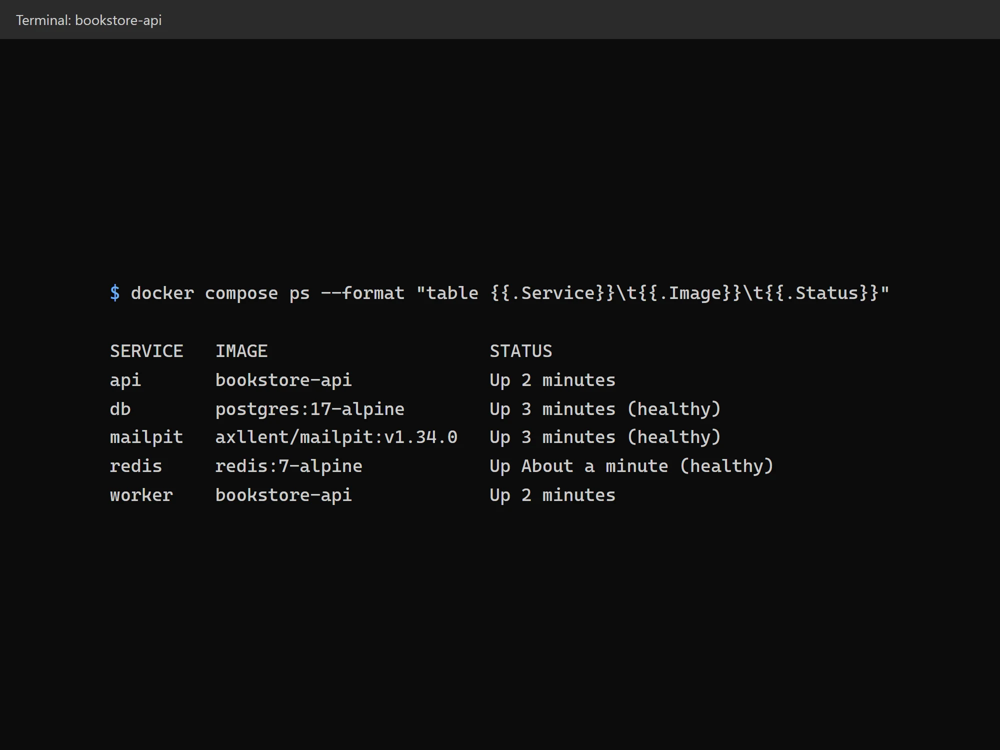

## What it does

Bookstore API is the backend of an online bookstore, built with FastAPI. Customers register, browse the catalog of authors, books and categories, and place orders. The API checks and reserves the stock in one transaction, answers straight away, and leaves the confirmation email to a background worker.

There are two roles. A customer reads the catalog, filters books by author, by category or by a search in the title, places orders, sees and cancels their own pending orders, and edits their profile. An administrator can also change the catalog, see every customer and order, and move an order from pending to paid to shipped. Every endpoint except registration and login needs a JWT.

Swagger UI documents the whole API, grouped by tag, and its Authorize button signs in with an email and password. One command seeds demo data: 5 authors, 4 categories, 10 books, 3 customers and 5 orders in different statuses.

## Architecture

Docker Compose runs five services:

- **api** is the FastAPI app. It runs the Alembic migrations every time it starts.
- **worker** is a Celery worker, built from the same image, that sends the confirmation emails.
- **db** is PostgreSQL 17, the only place the data is kept.
- **redis** holds the book cache in one database and the Celery queue in another.
- **mailpit** catches every outgoing email and shows it in a web UI.

The code is split by feature. Authors, books, categories, customers and orders each have their own folder with the same four files: models, schemas, service and router. Routers only deal with HTTP: they read the request, call a service and return the result. Services hold the rules and the queries, and the worker uses the same models and database as the API.

An order goes like this. `POST /orders` locks the rows of the ordered books, checks the stock, takes the quantities off, and saves the order and its items with the catalog prices, all in one transaction. Then it clears those books from the cache, puts the confirmation task on the queue with the order id, and answers `201`. The worker loads the order, its items and the customer from PostgreSQL and sends the email, in plain text and HTML.

## Decisions and why

- **The server decides prices and stock.** The client sends only book ids and quantities. Prices come from the catalog, and each item keeps the price it was sold at. The book rows stay locked (`SELECT … FOR UPDATE`) while the order is placed, so two orders at the same time can't sell the same last copy.
- **Email never slows down or breaks an order.** The API only queues the task. If Redis can't be reached, the order is still saved and the error is logged. The worker retries SMTP failures with backoff, up to three times.
- **The cache is best-effort.** A single book is served from Redis and cleared when the book or its stock changes. If Redis fails, the API leaves it alone for 30 seconds and reads from PostgreSQL, so a broken cache doesn't slow every request down with timeouts.
- **Services raise domain errors, not HTTP errors.** `NotFoundError` and `ConflictError` become `404` and `409` in one handler, so the business rules don't depend on FastAPI.
- **Order statuses follow fixed steps:** pending, then paid, then shipped, or cancelled. Any other change is refused with `409`, and cancelling puts the books back in stock.
- **Money is `NUMERIC(10,2)` and `Decimal`**, never floating point, and JSON returns prices as strings such as `"14.90"`.
- **Login uses the OAuth2 password form**, which is what lets Swagger's Authorize button work without any setup.

## Security

- **Passwords are hashed with Argon2.**
- **Tokens expire.** A JWT is valid for 60 minutes by default. An invalid or expired token, or one for an account that no longer exists, gets `401`.
- **Roles are checked on the server.** Admin endpoints answer `403` to customers, and customers only ever see their own orders.
- **Other people's orders don't exist.** Asking for someone else's order returns `404`, not `403`, so order ids don't leak.
- **Every request is validated** by Pydantic: email addresses, ISBNs of 10 or 13 digits, positive prices, quantities from 1 to 100, and passwords of 8 to 128 characters.
- **Settings come from the environment.** The JWT signing key and the connection strings are read from environment variables or a git-ignored `.env` file.
- **The container doesn't run as root**, and the email escapes book titles and names before they go into the HTML.

## Testing and deployment

There are 23 tests, written with pytest and httpx: 5 for sign-up and login, 10 for the catalog, 5 for orders and 3 for the order emails. They cover missing and invalid tokens, customers trying to change the catalog, filters, duplicate ISBNs, partial updates, an author with books that can't be deleted, stock reserved and returned, an order that runs out of stock leaving the stock unchanged, the status steps, and customers seeing only their own orders. The tests run on SQLite in memory, with Redis turned off and the Celery queue mocked, so they need no services.

A smoke test covers what those mocks replace. It runs against the real Docker stack: it checks the health of the database and Redis, checks that the Alembic migrations match the models on PostgreSQL, seeds the data, expects `401` without a token, signs in, lists the books, places an order, and waits for its email to arrive in Mailpit through the worker.

GitHub Actions runs the linters (black, isort, flake8) and the tests, then starts the stack with Docker Compose and runs the smoke test. It only runs when something that affects the build changes, so README edits don't start it. On a version tag, once both jobs pass, it builds the image, pushes it to the GitHub Container Registry and creates a GitHub release.

