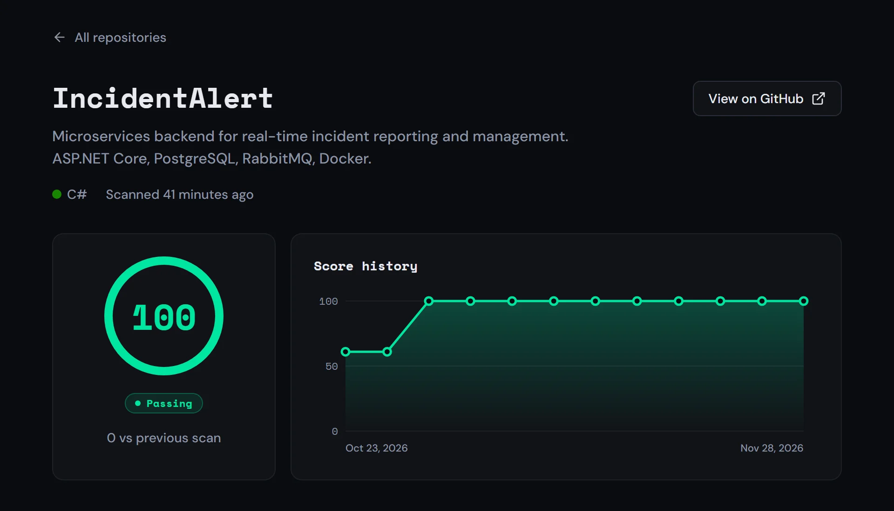
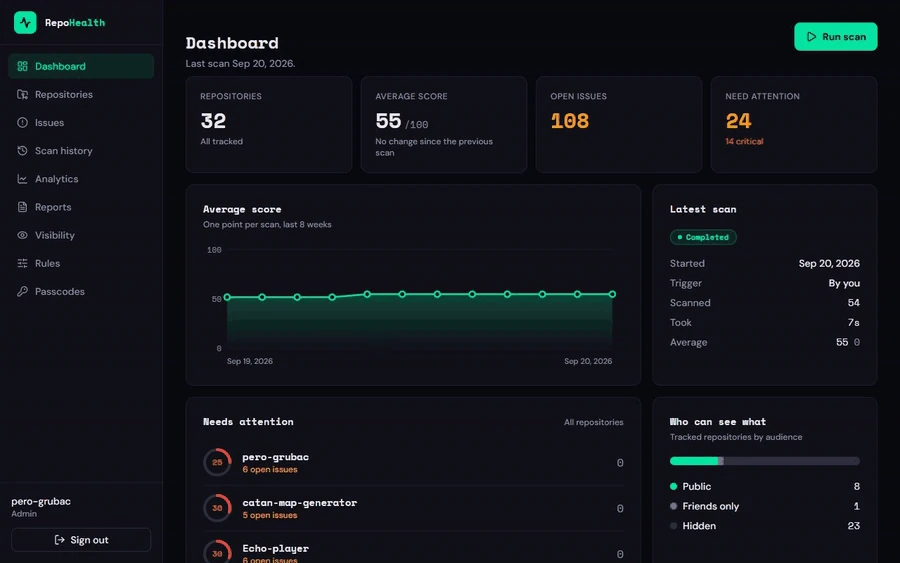
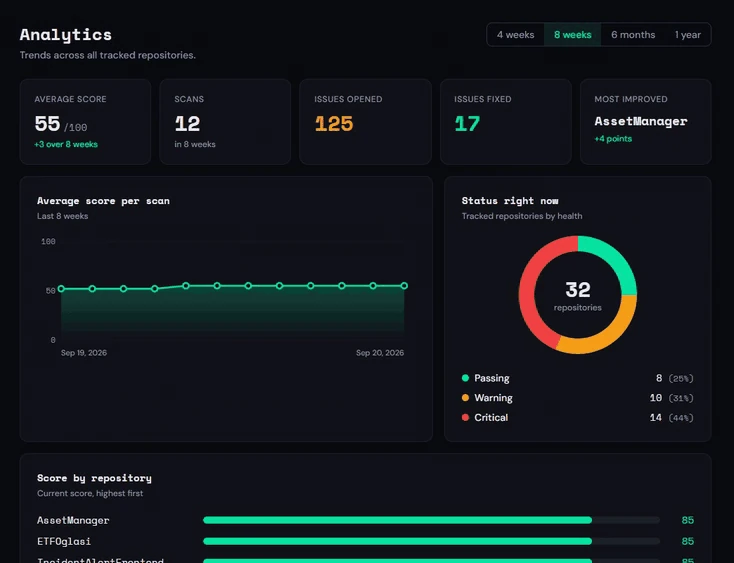

## What it does

RepoHealth scans the repositories of my GitHub account every week and scores each one from 0 to 100. It looks for a README with the required sections, a license, tests, a CI workflow, a `.gitignore` that fits the language, a description, and a commit in the last 180 days. A failing check becomes a tracked issue, the scores are kept over time, and from an issue I can open a real GitHub issue or a draft pull request with a suggested fix.

Three kinds of visitor see different things. Guests see the repositories I made public, with their score, status and trend. Friends sign in with a time-limited passcode I give them, and also see the friends-only repositories, every check, the open issues and the history. I sign in with GitHub as the admin: I run scans, edit the rules and weights, choose who sees which repository, hand out passcodes, and read the analytics and the weekly and monthly reports, which export to CSV.

## Architecture

The browser only ever talks to one address. Vercel serves the web app and forwards `/api/*` to the API on Render, so the session cookie stays first-party and there is no CORS to get wrong.

- **The web app** is Svelte 5 and SvelteKit, built as a static single-page app, with TanStack Query for fetching and Tailwind CSS for styling.
- **The API** is ASP.NET Core 10 in a Docker image on Render. It serves 34 routes in four groups: public, friend, sign-in and admin.
- **Background jobs** run in the same process: the weekly scan, a catch-up scan at start-up when the last one is more than a week old, and an hourly sync of the repository list and who may see each repository.
- **PostgreSQL** on Neon holds the repositories, scores, issues and history, through Entity Framework Core and seven migrations.
- **GitHub** is reached through Octokit, with three separate tokens.

A scan lists the repositories, fetches each one's README, license, file tree, last commit and `.gitignore` once, and runs the seven checks on that data. Each check returns a number from 0 to 1, and the weights in the rules turn them into a score. The results, the issues opened and the issues closed then go to the database. A manual scan answers `202` straight away and the app polls it. A lock makes sure two scans never run at once, and a scan left running by a crash is marked as failed at the next start.

## Decisions and why

- **The same origin for the app and the API.** Vercel's rewrite in production and Vite's proxy locally put both on one address, so the cookie is first-party and there is nothing to configure for CORS.
- **The checks are pure functions.** The data is fetched once per scan, each check returns a ratio, and the weights live in the rules, globally or per repository. That keeps the checks trivial to test, and the weights change without a deploy.
- **Hidden by default.** A new repository starts hidden, forks and archived ones are not tracked, and I decide who can see each of the rest.
- **The token is the real boundary.** Scanning uses a read-only token. Creating GitHub issues and opening pull requests each need a token of their own, with only the permissions that job needs, so a leaked scan token can't write anything.
- **Fixes are only ever drafts.** A suggested fix opens a draft pull request on a new branch, and each issue can create at most one GitHub issue and one pull request.
- **Scans never run inside a request.** Starting one returns `202`, so a slow GitHub never holds a request open.
- **The database prevents duplicate issues.** A unique index allows one open issue per repository, check and problem.

## Security

- **Sessions** are a signed JWT in an httpOnly, `SameSite=Strict` cookie, never in a URL or in JavaScript. Signing out bumps a session version, so the old token stops working.
- **Only one GitHub account can be the admin.** The sign-in accepts a single numeric GitHub user id.
- **Friends' passcodes** are stored as hashes and last at most 30 days. A passcode session is checked against its passcode on every request, so revoking one takes effect at once.
- **Private repositories are for the admin alone**, enforced in four places: the sync, the admin API that refuses to share them, the guest and friend queries, and a check constraint in the database.
- **Every changing request needs a CSRF header.** Rate limits guard the passcode sign-in, the GitHub sign-in and the public API, request bodies are capped at 16 KB (4 MB for the admin), and the API sends strict security headers.
- **The client address can't be spoofed.** It comes from `X-Forwarded-For` with a fixed number of trusted proxies.
- **The API refuses to start when it isn't safe.** It won't run with a missing or weak signing secret, and in production not without a connection string or with `AllowedHosts` set to `*`.
- **The Docker image is chiseled**: it runs without root and without a shell. The CSV export also neutralises spreadsheet formulas.

## Testing and deployment

The backend has 989 tests with xUnit: the checks, scoring, scans and issues, and the API hosted in memory with an in-memory database. A set of them are attack tests. One builds its list from the app's own route table, so a new anonymous route that isn't on the allow-list fails the build. Another scans the source so that only the three GitHub classes may use Octokit. Others send 21 malformed bodies and 31 hostile inputs (SQL injection, XSS, path traversal, CRLF and more), and check that no audience sees more than it should, that secrets never reach a response, that sign-out really ends a session, and that the rate limits hold. The web app adds 207 Vitest tests for its page logic.

GitHub Actions builds the API with warnings as errors, runs the tests, fails on vulnerable packages and builds the same Docker image Render does. It also type-checks, tests and builds the web app, and runs `npm audit`.

Everything runs on free tiers: the web app on Vercel, the API on Render from a Blueprint that applies the migrations at start-up, the database on Neon, and UptimeRobot calling `/health` every five minutes so Render doesn't fall asleep. That endpoint doesn't touch the database, so Neon can still sleep.

